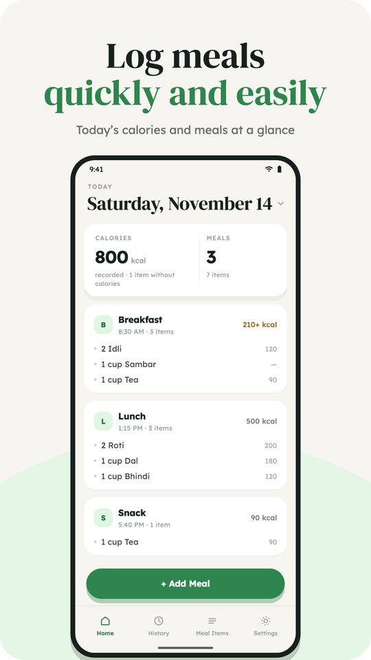
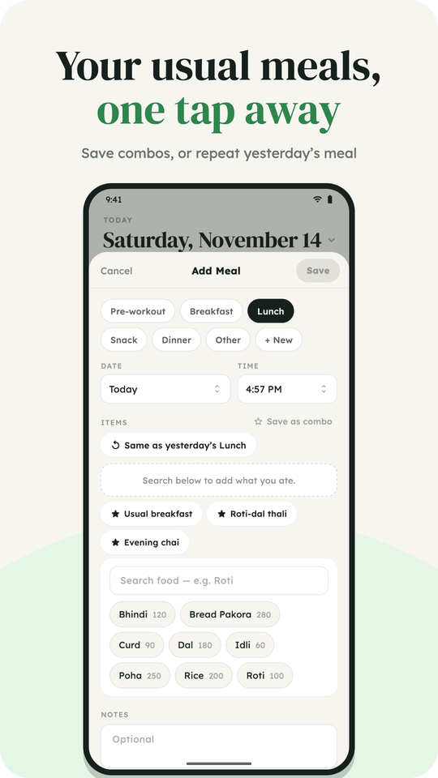
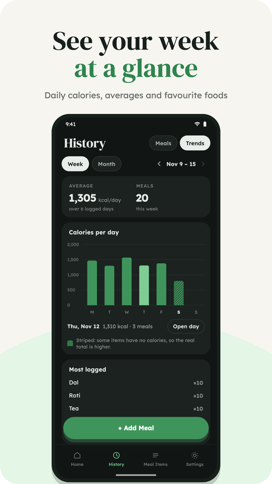
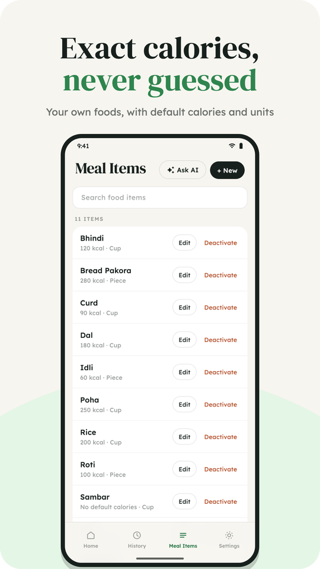
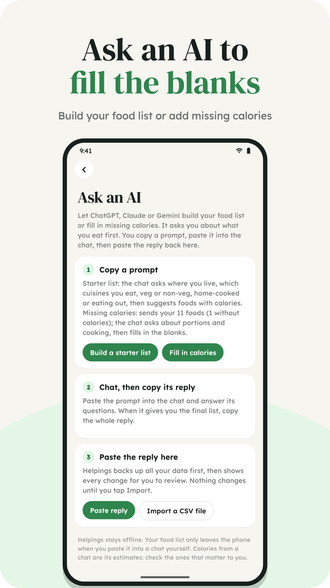

<p align="center">
  
</p>

<h1 align="center">Helpings</h1>

<p align="center">A calm, exact meal log for Android.</p>

<p align="center">
  <a href="pubspec.yaml"></a>
  <a href="LICENSE"></a>
  
  
</p>

Log what you ate quickly and easily, see today's calories at a glance, and
look back on any day.

Calories are never estimated. Totals add up only what you enter, and when a
line has no calories the total shows a `+` (for example `210+ kcal`) and says
what's missing. Everything stays on the phone: no account, no ads, no
analytics, and no internet permission.

Website and privacy policy: <https://helpings.mihirsolanki.in>

<p align="center">
  
  
  
  
  
</p>

## Features

**Logging**
- The meal type is pre-selected from the time of day.
- Search your own food list; quantity, unit and calories pre-fill from the
  food's defaults. A food that isn't on the list can be created from the search.
- Combos: save foods you eat together, then add them in one tap. Combos keep
  quantities and units; calories come from each food's current default.
- Repeat yesterday's meal, or "Log again" any past meal. Optional notes.

**Home, history and trends**
- Home shows the day's calories and meals; swipe between days or jump to a date.
- History groups meals by day with daily totals, filtered by meal type.
- Trends: calories per day for the week or month, the daily average, and the
  most-logged foods.

**Your foods and meal types**
- Starts with everyday foods (roti, dal, rice, idli, poha, tea…) with default
  calories and units (piece, gram, spoon, cup).
- Add your own units (scoop, bowl, glass…); rename, reorder or hide them.
- Give a food calories later and Helpings offers to fill in past meals that
  had none (scaled by quantity), and optionally to update lines with other
  values. Nothing changes without asking.
- Foods can be hidden from search or deleted; past meals keep their names.
- Meal types are editable: rename, reorder, hide, or add your own, each with
  an optional "usually starts at" time and a daily reminder.

**Ask an AI**
- Build a starter food list: copy a prompt into ChatGPT, Claude or Gemini. It
  asks where you live, which cuisines you eat, veg or non-veg, home-cooked or
  eating out, then suggests foods with calories and units.
- Fill in missing calories: copy your food list with a prompt. The chat asks
  about portions and cooking first, then fills in only the blanks.
- Paste the reply back. Helpings backs up all your data first (to your backup
  folder, or the app's own folder if you agree), then shows every change to
  review. New foods and blank calories are ticked; overwrites aren't. New units
  are created as needed, and food names are never changed.
- Offers to fill in past meals that had no calories, with Undo.
- Copy and paste only: the app still has no internet permission. Shown once
  in a short walkthrough on first launch; then in Meal Items → Ask AI.

**Your data**
- Save a backup copy, or keep daily backups in a folder you choose (the last
  30 are kept). Restore from any backup file.
- Export all meals as CSV, or the food list as CSV.
- Android home-screen widget with today's calories and an Add meal button.
- Light, dark, or follow the system.

## Platforms

Android is the supported platform and the one released on Google Play. The
code also builds for iOS, but the iOS home-screen widget isn't built yet (see
[docs/IOS_WIDGET.md](docs/IOS_WIDGET.md)) and iOS isn't released.

## Project layout

```
lib/
  data/       models, SQLite schema + migrations, repository, seed foods,
              backups, CSV export, trends, reminders, widget data
  state/      Riverpod providers (AppDataNotifier holds the in-memory snapshot)
  theme/      design tokens (light/dark), fonts, ThemeData
  ui/         shell (tabs), screens, sheets, shared widgets
android/      app, home-screen widget (HelpingsWidgetProvider.kt),
              backup-folder bridge (MainActivity.kt), fastlane store listing
test/         repository, migration and widget tests (in-memory SQLite via FFI)
tool/store_screenshots/  generates the Play Store screenshots and feature graphic
tool/readme_images.py    README logo, rounded screenshots, GitHub social preview
docs/         Play release guide, privacy policy, iOS widget notes, README images
assets/fonts/ Lexend + DM Serif Display (SIL Open Font License)
```

Data lives on-device in SQLite (`helpings.db`, via sqflite).

## Requirements

- Flutter 3.50+ (Dart 3.14)
- Android: a JDK 17+ (Android Studio's bundled JBR works) and the Android SDK
- iOS (optional): full Xcode plus CocoaPods

## Run

```sh
flutter pub get
flutter test                    # unit + widget tests, no device needed
flutter run --profile           # on a connected device (profile is smoother than debug)
```

Regenerate the store screenshots after UI changes:

```sh
flutter test tool/store_screenshots
python3 tool/readme_images.py   # README images (needs Pillow)
```

Releasing to Google Play is covered in [docs/PLAY_RELEASE.md](docs/PLAY_RELEASE.md).
Release builds are signed with the keystore named in `android/key.properties`
(git-ignored); without that file they fall back to the debug key, which is fine
for local testing.

## Schema changes

Bump `AppDatabase.version` in `lib/data/database.dart` and add a new
`if (from < N)` step to `_migrate`. Never edit a step that has shipped.
Backups from older versions are migrated on restore.

## Built with AI assistance

Helpings is developed with the help of AI: Anthropic's Claude (via Claude
Code) is used to write and review code, tests and documentation. Every change
is directed, reviewed and tested on a real device by the maintainer.

## License

Copyright (C) 2026 Mihir Solanki

Helpings is free software: you can redistribute it and/or modify it under the
terms of the GNU General Public License as published by the Free Software
Foundation, either version 3 of the License, or (at your option) any later
version. See [LICENSE](LICENSE).

The bundled fonts, Lexend and DM Serif Display, are under the SIL Open Font
License (`assets/fonts/OFL-*.txt`).
